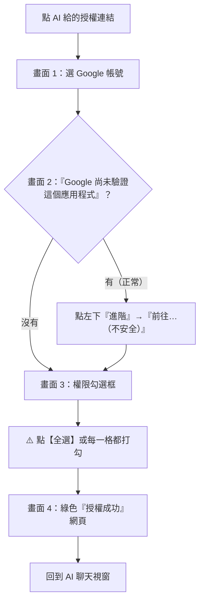

# 🎓 學生 Google 授權通關指南

授權過程只會遇到 **4 個畫面**。90% 卡關都在畫面 3「沒打勾」。

## 0 號步驟：先開 API 開關
👉 [script.google.com/home/usersettings](https://script.google.com/home/usersettings) → 「Google Apps Script API」切到 **On**。

> Google 預設是 Off。沒開的話，AI 上傳程式碼會出現 `API has not been used or disabled`。

## 4 個畫面

### 畫面 1：選帳號
- 請用個人 **@gmail.com**。
- 學校帳號（如 `@mail.edu.tw`）常被管理員限制，會出現「存取遭封鎖」。

### 畫面 2：「Google 尚未驗證這個應用程式」
- 這是正常提醒，不是病毒。
- 點左下灰色 **「進階」** → 最下方 **「前往…（不安全）」**。

### 畫面 3：權限勾選框（最常卡關）
- Google 把每項權限拆成獨立勾選框。**直接按「繼續」= 沒有權限**。
- 點最上面的 **【全選】**，或確認每一格都是藍色打勾，再按 **繼續**。
- 漏勾的話，精靈會列出缺少的權限，重跑一次就好。

### 畫面 4：綠色成功網頁
- 看到「🎉 授權已順利完成！」→ 關掉分頁，回到 AI 聊天視窗。

## 錯誤對照表

| 看到的訊息 | 原因 | 解法 |
|---|---|---|
| `API has not been used or disabled` | Apps Script API 開關沒開 | 到 [usersettings](https://script.google.com/home/usersettings) 切到 **On** |
| `403 Insufficient Permission` 或精靈顯示「缺少權限」 | 畫面 3 漏勾 | 請 AI 重跑授權，按【全選】 |
| `Access blocked` / 存取遭封鎖 | 學校或公司帳號限制 | 改用個人 @gmail.com |
| `This site can't be reached (localhost:54321)` | 精靈已逾時（5 分鐘）或沒在執行 | 請 AI 重新啟動授權 |
| 連接埠被佔用 | 54321 被先前未結束的視窗佔用 | 關閉先前命令視窗，稍候 5 秒重試 |
| `python` 找不到 | 電腦沒裝 Python 或沒加進 PATH | Windows 請直接使用 `easy_auth.ps1`（零依賴免裝 Python） |
| 授權成功但 AI 看不到 Google 工具 | MCP 還沒重新載入 | 重新啟動 AI 工具 |

## 安全提醒
- `~/.clasprc.json` 和 MCP 設定裡的 Refresh Token 等同你的 Google 鑰匙，**不要上傳、不要傳給同學**。
- 課程結束想取消授權：[myaccount.google.com/permissions](https://myaccount.google.com/permissions) → 移除存取權。
