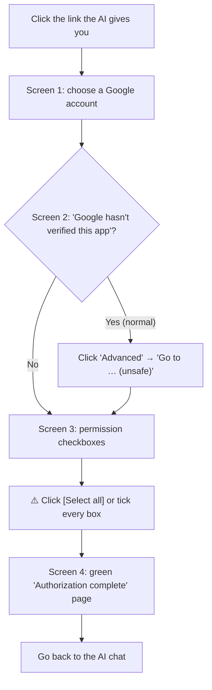

# 🎓 Student guide to Google authorization

You will only see **4 screens**. 90% of students who get stuck are on screen 3: "didn't tick the boxes".

## Step 0: turn on the API switch
👉 [script.google.com/home/usersettings](https://script.google.com/home/usersettings) → set "Google Apps Script API" to **On**.

> It is Off by default. If it stays Off, uploading code fails with `API has not been used or disabled`.

## The 4 screens

### Screen 1: choose an account
- Use a personal **@gmail.com** account.
- School accounts (e.g. `@mail.edu.tw`) are often restricted by the admin and show "Access blocked".

### Screen 2: "Google hasn't verified this app"
- This is a normal notice, not a virus.
- Click the grey **"Advanced"** at the bottom left → **"Go to … (unsafe)"** at the bottom.

### Screen 3: permission checkboxes (where most students get stuck)
- Google shows each permission as its own checkbox. **Clicking "Continue" without ticking = no permissions.**
- Click **[Select all]** at the top, or make sure every box is ticked blue, then click **Continue**.
- If you miss one, the wizard lists what is missing — just run it again.

### Screen 4: green success page
- When you see "🎉 Authorization complete!", close the tab and go back to the AI chat.

## Error table

| Message | Cause | Fix |
|---|---|---|
| `API has not been used or disabled` | Apps Script API switch is Off | Set it **On** at [usersettings](https://script.google.com/home/usersettings) |
| `403 Insufficient Permission`, or the wizard says permissions are missing | A box was not ticked on screen 3 | Ask the AI to run authorization again and click [Select all] |
| `Access blocked` | School or company account restriction | Use a personal @gmail.com account |
| `This site can't be reached (localhost:54321)` | The wizard timed out (5 min) or isn't running | Ask the AI to start authorization again |
| Port already in use | Another program is using 54321 | Ask the AI to rerun with `--port 54322` |
| `python` not found | Python isn't installed | Ask the AI to install Python 3 |
| Authorized, but the AI can't see Google tools | MCP hasn't been reloaded | Restart the AI tool |

## Security
- `~/.clasprc.json` and the refresh token in the MCP config are a key to your Google account. **Never upload them or share them with classmates.**
- To remove access after the course: [myaccount.google.com/permissions](https://myaccount.google.com/permissions) → remove access.
